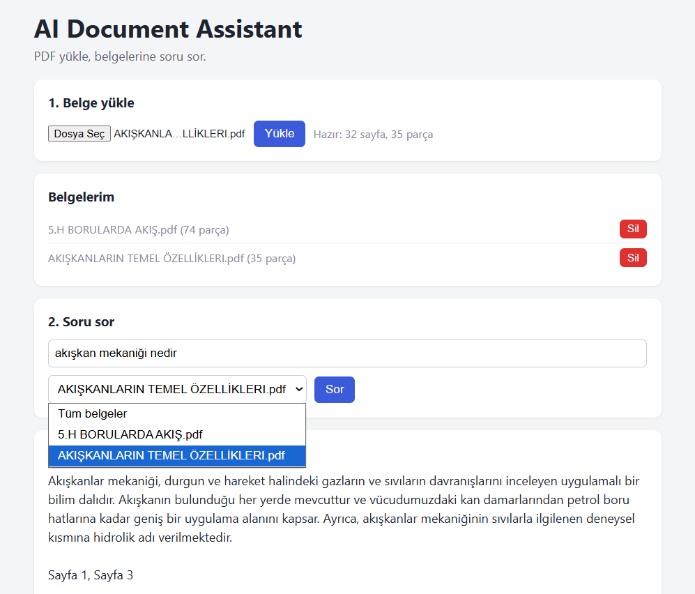

# AI Document Assistant

A Retrieval-Augmented Generation (RAG) application that answers questions about your PDF documents. Upload a PDF, ask a question in natural language, and get an answer grounded in the document, with the source pages shown.



## Features

- **PDF question answering** with answers based only on the retrieved document content
- **Source citations**: every answer shows which file and page it came from, with similarity scores
- **Multilingual retrieval**: ask in Turkish about an English document, or the other way around
- **Multi-document support**: upload several PDFs, then search all of them or filter by one
- **Document management**: list and delete uploaded documents
- **Simple web UI** and an auto-generated API documentation page (`/docs`)

## How it works

```
 PDF ──► Text extraction ──► Chunking ──► Embeddings ──► ChromaDB
                                                            │
 Question ──► Embedding ──► Semantic search (top-k) ◄───────┘
                                   │
                                   ▼
                  Retrieved chunks + question ──► LLM ──► Answer + sources
```

1. **Extract**: `pypdf` reads each page and keeps the page number.
2. **Chunk**: text is split on line boundaries into ~600-character chunks with 200 characters of overlap, so context is not lost at the edges.
3. **Embed**: each chunk becomes a vector with `paraphrase-multilingual-MiniLM-L12-v2` (runs locally, no API key needed).
4. **Store**: vectors and metadata (file name, page) are saved in ChromaDB with cosine similarity.
5. **Retrieve**: the question is embedded and the most similar chunks are found.
6. **Generate**: the chunks and the question are sent to Gemini with an instruction to answer only from the provided context and say so when the answer is not there.

## Tech stack

| Layer | Technology |
|---|---|
| API | FastAPI, Uvicorn |
| PDF parsing | pypdf |
| Embeddings | sentence-transformers (multilingual MiniLM) |
| Vector database | ChromaDB (persistent, local) |
| LLM | Google Gemini API |
| Frontend | Plain HTML, CSS and JavaScript |

## Project structure

```
rag-document-assistant/
├── main.py                # FastAPI app and endpoints
├── app/
│   ├── pdf_processor.py   # PDF text extraction
│   ├── chunker.py         # Text chunking with overlap
│   ├── embedder.py        # Embedding generation
│   ├── vector_store.py    # ChromaDB storage and search
│   └── llm.py             # Prompt building and Gemini call
├── static/
│   └── index.html         # Web interface
├── docs/
│   └── screenshot.png
├── requirements.txt
└── .env.example
```

## Getting started

### Prerequisites

- Python 3.10 or newer
- A Gemini API key from [Google AI Studio](https://aistudio.google.com)

### Installation (Windows PowerShell)

```powershell
git clone https://github.com/byzakeskin/rag-document-assistant.git
cd rag-document-assistant

python -m venv venv
.\venv\Scripts\Activate.ps1

pip install -r requirements.txt
```

On macOS/Linux, activate the environment with `source venv/bin/activate` instead.

### Configuration

Copy `.env.example` to `.env` and add your key:

```
GEMINI_API_KEY=your_api_key_here
GEMINI_MODEL=gemini-3-flash-preview
```

Model names change over time. If you get a "model not found" error, check the current name in Google AI Studio and update `GEMINI_MODEL`.

### Run

```powershell
uvicorn main:app --reload
```

The first start downloads the embedding model (a few hundred MB) and can take a few minutes. Then open:

- Web interface: http://127.0.0.1:8000
- API docs: http://127.0.0.1:8000/docs

## API endpoints

| Method | Endpoint | Description |
|---|---|---|
| `POST` | `/upload` | Upload a PDF; it is processed and indexed |
| `POST` | `/ask` | Ask a question; returns the answer and its sources |
| `GET` | `/documents` | List indexed documents |
| `DELETE` | `/documents/{filename}` | Delete a document |
| `GET` | `/health` | Health check |

Example request:

```json
POST /ask
{
  "question": "Which databases does the candidate know?",
  "top_k": 5,
  "source": "my_document.pdf"
}
```

`top_k` (default 5) and `source` (optional file name filter) can be omitted.

## Limitations

- Scanned PDFs (images of text) are not supported, since there is no OCR step.
- Chunking is character-based, so very different document layouts may need tuning of the chunk size and overlap.
- Document text is sent to the Gemini API. Do not upload sensitive documents unless that fits your privacy needs.
- No authentication: this is meant for local use or demos.

## Roadmap

- Smarter chunking by sections and paragraphs
- OCR support for scanned PDFs
- Streaming answers in the UI
- Evaluation set to measure retrieval quality
- Docker setup

## License

MIT